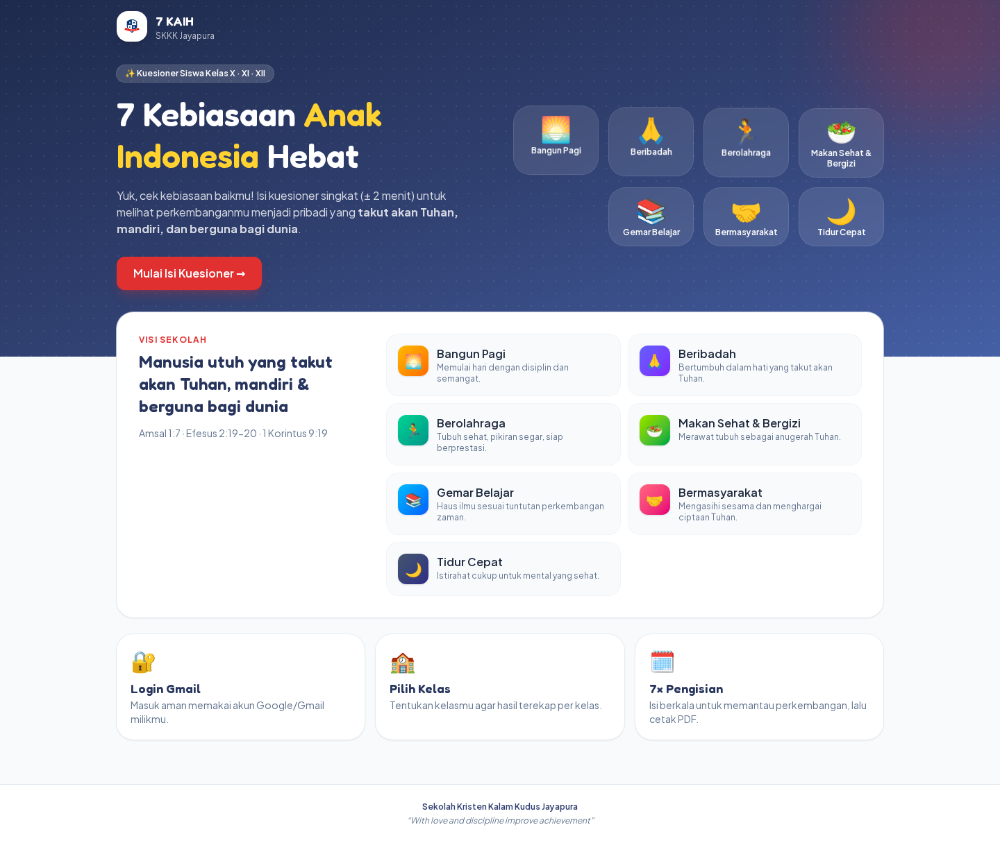
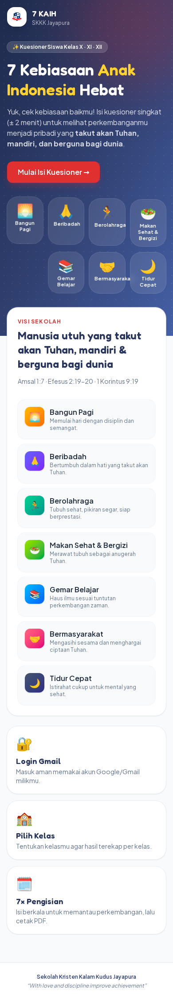

<div align="center">
  

  <h1>7 KAIH · Anak Indonesia Hebat</h1>

  <p><strong>Platform kuesioner untuk menumbuhkan dan memantau 7 Kebiasaan Anak Indonesia Hebat.</strong><br />
  Dikembangkan untuk Sekolah Kristen Kalam Kudus Jayapura.</p>

<p align="center">
  <a href="https://laravel.com/"></a>
  <a href="https://www.php.net/"></a>
  <a href="https://tailwindcss.com/"></a>
  <a href="LICENSE"></a>
</p>

<p align="center">
  <strong><a href="https://anakindonesiahebat.my.id/">🌐 Buka Aplikasi</a></strong> ·
  <a href="#-fitur">✨ Lihat Fitur</a> ·
  <a href="#-menjalankan-proyek">🚀 Menjalankan Proyek</a>
</p>

  
</div>

<details>
  <summary><strong>📱 Lihat tampilan mobile</strong></summary>
  <br />
  <p align="center">
    
  </p>
</details>

## ✨ Tentang Aplikasi

**7 KAIH** membantu siswa melakukan refleksi berkala atas kebiasaan sehari-hari, sekaligus memberi sekolah data yang mudah dibaca untuk pendampingan dan evaluasi. Setiap pengisian menghasilkan skor per kebiasaan, kategori perkembangan, visualisasi tren, dan laporan PDF.

Tujuh kebiasaan yang dipantau:

| | | | |
|---|---|---|---|
| 🌅 **Bangun Pagi** | 🙏 **Beribadah** | 🏃 **Berolahraga** | 🥗 **Makan Sehat & Bergizi** |
| 📚 **Gemar Belajar** | 🤝 **Bermasyarakat** | 🌙 **Tidur Cepat** | |

## 🚀 Fitur

### 🧒 Untuk Siswa

- **Login dengan Google** dan pembatasan domain email yang dapat dikonfigurasi.
- **Pemilihan kelas** untuk siswa kelas X, XI, dan XII.
- **Kuesioner interaktif** dengan skala empat tingkat dan kolom refleksi.
- **Pengisian berkala hingga 7 kali**, lengkap dengan indikator progres.
- **Hasil yang mudah dipahami:** skor setiap kebiasaan, kategori perkembangan, dan grafik tren antarpengisian.
- **Riwayat dan rekap pribadi** yang dapat diunduh sebagai PDF.

### 📊 Untuk Admin & Super Admin

- **Dashboard statistik** berisi partisipasi siswa, rata-rata kebiasaan, distribusi kategori, tren pengisian, dan perbandingan kelas.
- **Filter data** berdasarkan tingkat dan kelas.
- **Manajemen hasil kuesioner**, termasuk detail jawaban, penghapusan hasil, dan laporan PDF agregat.
- **CRUD pengguna:** tambah akun, edit nama/email/kelas, atur role, reset password, dan hapus pengguna.
- **Manajemen kelas:** tambah, ubah, aktif/nonaktifkan, dan hapus kelas sesuai ketersediaan data.
- **Manajemen pertanyaan:** tambah dan ubah instrumen per kebiasaan; pertanyaan lama dapat dinonaktifkan agar riwayat tetap konsisten.
- **Hak akses berbasis role** untuk `user`, `admin`, dan `super_admin`.

## 🛠️ Teknologi

| Bagian | Teknologi |
|---|---|
| Backend | PHP 8.4, Laravel 13 |
| Frontend | Blade, Tailwind CSS 4, Vite |
| Autentikasi | Laravel Socialite · Google OAuth |
| Database | SQLite untuk pengembangan/testing; kompatibel dengan konfigurasi database Laravel |
| PDF | DomPDF |
| Pengujian | PHPUnit dengan database SQLite in-memory |

## 📦 Menjalankan Proyek

### Prasyarat

- PHP 8.3 atau lebih baru dan Composer
- Node.js serta npm
- Database yang didukung Laravel

### Instalasi

```bash
git clone https://github.com/wiratmoko1708/anakindonesiahebat.git
cd anakindonesiahebat

composer install
cp .env.example .env
php artisan key:generate
```

Untuk SQLite, buat database lalu jalankan migrasi dan seeder:

```bash
touch database/database.sqlite
php artisan migrate --seed
```

Kemudian bangun aset dan jalankan server:

```bash
npm install
npm run build
php artisan serve
```

### Konfigurasi penting

Sesuaikan nilai berikut di `.env`:

| Variabel | Fungsi |
|---|---|
| `APP_URL` | URL publik aplikasi |
| `GOOGLE_CLIENT_ID`, `GOOGLE_CLIENT_SECRET` | Kredensial Google OAuth |
| `GOOGLE_REDIRECT_URI` | URL callback Google OAuth |
| `KAIH_ALLOWED_EMAIL_DOMAINS` | Daftar domain email yang diizinkan, dipisahkan koma |
| `KAIH_SUPER_ADMIN_EMAILS` | Email yang otomatis menjadi Super Admin saat login |
| `KAIH_MAX_SUBMISSIONS` | Batas pengisian per siswa; default `7` |
| `KAIH_DEV_LOGIN` | Login demo khusus pengembangan lokal |

> [!WARNING]
> Untuk produksi, gunakan `APP_ENV=production`, `APP_DEBUG=false`, dan `KAIH_DEV_LOGIN=false`. Jangan pernah memcommit file `.env` atau backup database.

## ✅ Pengujian

```bash
composer test
```

Test mencakup autentikasi Google, pembatasan akses role, batas pengisian kuesioner, dan CRUD pengguna.

## 🔐 Hak Akses

| Kemampuan | Siswa | Admin | Super Admin |
|---|:---:|:---:|:---:|
| Mengisi kuesioner dan melihat rekap sendiri | ✅ | ✅* | ✅* |
| Dashboard dan laporan sekolah | — | ✅ | ✅ |
| **Mengelola kelas dan pertanyaan** | — | ✅ | ✅ |
| **Menghapus hasil kuesioner** | — | — | ✅ |
| Menambah/mengedit akun dan mengubah role | — | — | ✅ |
| Menghapus pengguna | — | — | ✅ |

\* Admin dan Super Admin dapat menggunakan fitur siswa setelah memilih kelas.

## 📄 Lisensi

Proyek ini dilisensikan di bawah [GNU General Public License v3.0](LICENSE).

---

<div align="center">
  <strong>Sekolah Kristen Kalam Kudus Jayapura</strong><br />
  <em>“With love and discipline improve achievement”</em>
</div>
